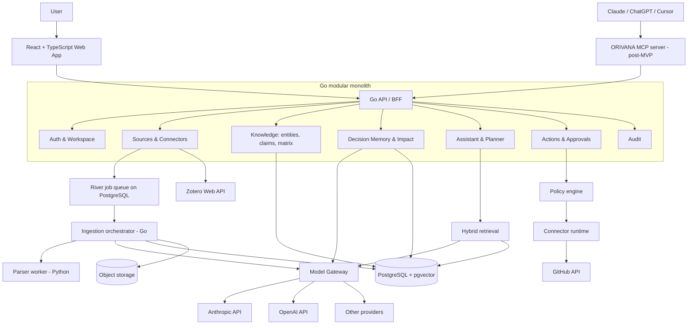
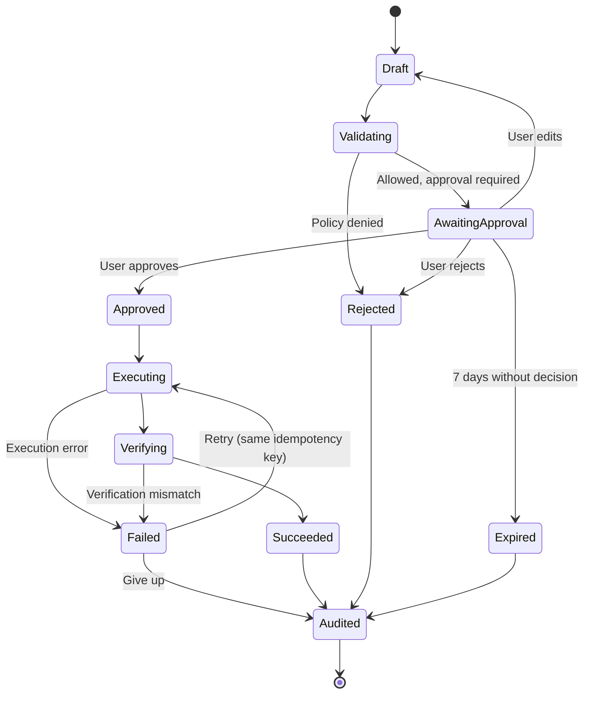

# ORIVANA — Product Requirements Document

> **Product:** ORIVANA\
> **Category:** Personal Intelligence & Action Platform\
> **Tagline:** Your Knowledge, Connected. Your Intent, in Motion.\
> **Document status:** MVP baseline — rewritten from scratch\
> **Version:** 2.0\
> **Date:** 12 November 2026\
> **Companion documents:** `UI.md` (design specification), `README.md` (overview and workflow)

---

## 0. Document control

### 0.1 Changelog

| Version | Date | Summary |
|---|---|---|
| 1.0 | 11 Nov 2026 | Initial blueprint. |
| 1.1 | 11 Nov 2026 | Consistency fixes, locked persona and connector, extended data model and API, milestones. |
| 2.0 | 12 Nov 2026 | Rewritten from scratch. New positioning against real competitors (NotebookLM, Perplexity, Elicit, Scite, ResearchRabbit/Litmaps, Zotero + AI plugins). Knowledge views became **Matrix · Claims · Map**. Added **Decision Impact** as the flagship feature. Added **Zotero** as a read-only source. Clarified that search is within the user's collection only. Added **multi-provider Model Gateway**, model preferences, and a post-MVP **ORIVANA MCP server** usable from Claude and ChatGPT. Added gap-driven discovery to the roadmap. Added Phase 0 validation questions and a multi-model evaluation experiment. |

### 0.2 Current status

- Product blueprint and UI design: complete (35 artboards in Claude Design, exported to `docs/design/screens/`).
- Frontend prototype: built with Claude Code in phases 0–7 (React + mock JSON contracts). Phase 8 adds the v2.0 features listed in §21.
- Backend (Go): not started.
- Name: working brand, not legally cleared.

### 0.3 How to read this document

- §1–§5 explain **why** ORIVANA exists and **who** it is for.
- §6–§10 define **what** to build.
- §11–§17 define **how** to build it.
- §18–§26 cover quality, validation, roadmap, and risks.

---

## 1. Executive summary

### 1.1 One sentence

**ORIVANA helps researchers keep their decisions aligned with the evidence in their own papers — and act on it with control.**

### 1.2 The short pitch

Researchers already have good tools to **find** papers (Google Scholar, ResearchRabbit, Perplexity), **store** them (Zotero), and **ask questions** about them (NotebookLM, Zotero AI plugins). What no tool does well is keep track of **what the researcher decided, why, and whether that is still supported by the evidence** — and turn that into the next concrete step.

ORIVANA fills that gap:

1. **Understand** — turns a researcher's own papers into structured knowledge: which methods were tested on which datasets (Matrix), which claims are supported or contradicted (Claims), and how everything connects (Map). Every cell and edge links to the exact page that supports it.
2. **Decide** — records research decisions with rationale, evidence, and history ("use chunk size 256 instead of 512, because of experiment X").
3. **Watch** — when a new paper contradicts a claim a decision depends on, ORIVANA flags the decision for review (**Decision Impact**).
4. **Act** — proposes the next step (for example a GitHub issue to re-run an experiment), shows exactly what will happen, and runs it only after approval.

### 1.3 Positioning statement

> NotebookLM helps you read your papers.\
> Perplexity helps you search the web.\
> **ORIVANA keeps your research decisions honest — and moves them forward.**

### 1.4 Core thesis: Knowledge-to-Action Intelligence

```
Collect  →  Understand  →  Decide  →  Watch  →  Act  →  Audit
(papers)    (matrix,       (decision   (decision  (approved  (what happened
             claims, map)   memory)     impact)    actions)   and why)
```

Each step produces data the next step uses. The loop is the product; no single step is unique on its own.

### 1.5 Product boundary

ORIVANA:

- works **only on the user's own collection** (uploaded files and Zotero library); it does not search the web in the MVP;
- does **not** claim factual correctness; it shows evidence and lets the user judge;
- does **not** run any write action without explicit approval;
- does **not** replace Zotero, a reference manager, or a paper-discovery tool — it complements them.

### 1.6 Brand identity

| Attribute | Value |
|---|---|
| Product name | ORIVANA (coined working name) |
| Category | Personal Intelligence & Action Platform |
| Tagline | Your Knowledge, Connected. Your Intent, in Motion. |
| Core idea | Connect knowledge, preserve decisions, turn informed intent into controlled action. |
| Personality | Thoughtful, precise, calm, capable, human-centered. |
| Voice | Clear, grounded, transparent about uncertainty. |

Use the category and tagline exactly as written. Never describe the product as "autonomous".

The name is not a statement of trademark or domain availability. A preliminary web search found unrelated businesses named "Orivana" in the food sector; complete trademark, company-name, domain, and social-handle checks before public launch.

---

## 2. Problem

### 2.1 The researcher's reality

A postgraduate researcher working on a thesis typically:

- collects 20–100 papers over several months (in Zotero or a folder);
- reads them partially and repeatedly;
- writes a literature review that compares methods, datasets, and findings;
- makes many small research decisions (which baseline, which dataset, which chunk size, which metric);
- runs experiments in a code repository (often on GitHub);
- explains and defends those decisions to a supervisor.

### 2.2 Pain points

| # | Pain | Example | Today's workaround |
|---|---|---|---|
| P1 | Evidence is hard to locate again | "Which paper said hybrid retrieval beats dense-only, and on which page?" | Re-open many PDFs; search manually |
| P2 | Comparisons across papers are manual | Building a table of methods × datasets by hand | Spreadsheets, often outdated |
| P3 | Contradictions are missed | Two papers disagree but the researcher only remembers one | Rely on memory |
| P4 | Decisions lose their rationale | "Why did we switch to chunk size 256?" two months later | Scattered notes, chat logs |
| P5 | New evidence does not reach old decisions | A new paper undermines an earlier choice; nobody notices | Nothing |
| P6 | Follow-up work is a manual handoff | Copying a finding into a GitHub issue by hand | Copy-paste |
| P7 | AI answers are hard to trust | A chatbot answer without verifiable sources | Avoid AI or double-check everything |

P1, P2, and P7 are partly solved by existing tools (§3). **P4, P5, and P6 are not**, and they are where ORIVANA must win.

### 2.3 Why now

- Large language models can now extract structured information (methods, datasets, claims) from papers at acceptable cost.
- Researchers already accept source-grounded AI (NotebookLM, Elicit), so trust in cited answers is established.
- Open standards like MCP make it possible to expose a product's knowledge to the AI assistants people already use (Claude, ChatGPT).

---

## 3. Market and competitive landscape

> Information below reflects publicly available descriptions as of November 2026. Features change quickly; re-verify before making any public comparative claim.

### 3.1 Categories

| Category | Examples | What it does well |
|---|---|---|
| Paper discovery (citation graphs) | ResearchRabbit, Litmaps, Connected Papers, Semantic Scholar | Find related papers in catalogues of hundreds of millions of papers |
| AI web search | Perplexity | Real-time web answers with citations; choice of frontier models |
| Source-grounded notebooks | NotebookLM | Cited answers over uploaded sources; mind maps; audio/video overviews |
| Evidence extraction | Elicit | Structured tables (methods, findings, limitations) from papers |
| Citation intelligence | Scite | Classifies citing statements as supporting, contrasting, or mentioning across a global corpus |
| Reference management + AI plugins | Zotero with plugins (e.g. Beaver, llm-for-zotero, seerai, PapersGPT) | Chat with the whole library, citations to passages, extraction, agent mode inside Zotero, MCP access |

### 3.2 Comparison

| Capability | NotebookLM | Perplexity | Elicit | Scite | ResearchRabbit / Litmaps | Zotero + AI plugins | **ORIVANA** |
|---|---|---|---|---|---|---|---|
| Cited Q&A over own sources | ✅ | ⚠️ Spaces, limited files | ✅ | ⚠️ | ❌ | ✅ | ✅ |
| Web / catalogue discovery | ⚠️ | ✅ | ✅ | ✅ | ✅ | ⚠️ | ❌ (post-MVP: gap-driven) |
| Method × Dataset matrix with evidence | ❌ | ❌ | ⚠️ tables per paper | ❌ | ❌ | ⚠️ extraction | ✅ |
| Supported / contradicted claims within own collection | ⚠️ contradiction analysis on request | ❌ | ⚠️ | ⚠️ global corpus | ❌ | ⚠️ | ✅ |
| Decision memory with rationale and history | ❌ | ⚠️ Spaces instructions | ❌ | ❌ | ❌ | ⚠️ notes | ✅ |
| Decision Impact alerts | ❌ | ❌ | ❌ | ⚠️ alerts on cited papers | ⚠️ new-paper alerts | ❌ | ✅ |
| External actions with preview, approval, audit | ❌ | ⚠️ general agent | ❌ | ❌ | ❌ | ⚠️ inside Zotero only | ✅ |
| Model choice | ❌ | ✅ | ❌ | ❌ | ❌ | ✅ (BYOK) | ✅ (gateway) |

Legend: ✅ core capability · ⚠️ partial or different form · ❌ not a known feature.

### 3.3 What is commoditized

These are **expected**, not differentiating. ORIVANA must have them, but must not sell itself on them:

- cited answers over uploaded documents;
- choosing between AI models;
- uploading PDFs;
- a visual graph or mind map by itself.

### 3.4 ORIVANA's wedge

ORIVANA wins only where the loop matters:

1. **Structured evidence:** Matrix and Claims views, each cell or claim linked to the page that supports it.
2. **Decision memory:** decisions as first-class records with rationale, evidence, status, and supersession history.
3. **Decision Impact:** new evidence is automatically checked against claims that existing decisions depend on.
4. **Governed action:** follow-up actions are generated from decisions and evidence, previewed, approved, executed, verified, and audited.

### 3.5 Complement, not compete

```
Discover (ResearchRabbit, Scholar, Perplexity)
   ↓  researcher saves papers
Store (Zotero)
   ↓  read-only import
Understand · Decide · Watch (ORIVANA)
   ↓  approved actions
Act (GitHub)
```

ORIVANA should integrate with the tools researchers already use rather than replace them.

---

## 4. Users

### 4.1 Primary persona (locked for MVP)

**Postgraduate / final-year researcher in a computational field who uses Zotero and GitHub.**

| Attribute | Description |
|---|---|
| Context | Thesis or research project lasting 6–18 months |
| Collection size | 20–150 papers, plus personal notes |
| Tools | Zotero, a PDF reader, Google Scholar or ResearchRabbit, GitHub, a chat assistant |
| Goals | Write a defensible literature review; make and justify research decisions; run experiments |
| Frustrations | Losing track of evidence and rationale; manual comparison tables; missing contradictions |
| Success | "I can show my supervisor exactly why we chose this approach and that it still holds." |

### 4.2 Secondary (later)

- Supervisors who want visibility into a student's decisions and evidence (read-only sharing).
- Small research groups sharing a project.
- Technical leads with documentation, ADRs, and issues (developer persona).

### 4.3 Not targeted in MVP

- Regulated enterprise workflows.
- Medical, legal, or financial decision-making.
- Users who need web-scale paper discovery inside the product.

### 4.4 Jobs to be done

| ID | Job | Feature |
|---|---|---|
| J1 | "Find what my papers say about X, with the exact page." | Assistant |
| J2 | "Show me which methods were tested on which datasets, and where the gaps are." | Matrix |
| J3 | "Show me which claims are supported or contradicted in my collection." | Claims |
| J4 | "Record why I made this decision, with evidence." | Decision memory |
| J5 | "Tell me when new evidence undermines a decision I made." | Decision Impact |
| J6 | "Turn this finding into a GitHub issue, but let me check it first." | Actions & Approvals |
| J7 | "Show me what the system did and let me control my data." | Activity, Settings |

---

## 5. Product principles

1. **Evidence before confidence.** Every answer, matrix cell, claim, and decision links to source passages.
2. **Within your collection.** ORIVANA reasons over the user's own sources only; it never mixes in unseen web content in the MVP.
3. **Decisions are first-class.** A decision is a record with rationale, evidence, status, and history — not a chat message.
4. **Time matters.** Current, historical, and superseded knowledge are always distinguishable.
5. **Permission before action.** Read, write, send, delete, and publish are separate permissions; every write needs approval in the MVP.
6. **User-owned context.** Users can inspect, correct, export, and delete everything.
7. **Provider independence.** AI models and connectors are replaceable behind interfaces.
8. **Complement existing tools.** Integrate with Zotero and GitHub instead of rebuilding them.
9. **No magical claims.** Show what the system knows, where it came from, and how confident it is.

---

## 6. Core concepts (glossary)

| Concept | Definition |
|---|---|
| Workspace | A user's private boundary for all data. |
| Project | A research context (e.g. "RAG Comparison") grouping sources, decisions, conversations, and actions. |
| Source | An original item: an uploaded file or a Zotero item. |
| Chunk | A passage of a source with page, section, and character offsets. |
| Evidence | A specific chunk span (quote + location) that supports something. |
| Entity | A node extracted from content: Paper, Method, Dataset, Claim, Concept (plus Project, Decision). |
| Relationship | A typed edge between entities (e.g. USES_METHOD, EVALUATES_ON, SUPPORTS, CONTRADICTS), with evidence, confidence, and status. |
| Matrix | A derived view: Methods × Datasets, where each cell lists the papers that evaluate that method on that dataset. |
| Claim | A statement made by one or more papers (e.g. "Hybrid retrieval outperforms dense-only retrieval on open-domain QA"). |
| Decision | A memory record of type `project` and kind `decision`, with statement, rationale, evidence, status, and supersession links. |
| Decision dependency | A link from a decision to the claims it relies on. |
| Decision alert | A flag raised when a dependency is weakened (e.g. a new CONTRADICTS edge on a claim a decision relies on). |
| Action proposal | A structured, previewable write action (e.g. create a GitHub issue). |
| Approval | The user's explicit decision to run, edit, or reject a proposal. |
| Audit event | An immutable record of something that happened. |

---

## 7. Scope

### 7.1 MVP features

| ID | Feature | Description | Acceptance criteria |
|---|---|---|---|
| F1 | Authentication | Sign up, verify email, sign in, sign out, reset password | Protected routes; verified email required before ingestion |
| F2 | Workspace & projects | One personal workspace; multiple projects | User sees only their own data (isolation tests pass) |
| F3 | Upload ingestion | PDF, Markdown, TXT | Job status visible; errors explained; retry available |
| F4 | Zotero import (read-only) | Connect Zotero; choose collections; import items, PDFs, and highlights; incremental sync | Imported items show a Zotero badge; sync is idempotent; nothing is written back to Zotero |
| F5 | Source library & viewer | Browse, filter, reprocess, delete; page viewer with highlighted passages | Every chunk links to source, page, and section |
| F6 | Evidence-grounded assistant | Ask questions within project or workspace scope; streaming; page-level citations | Each citation refers to a retrieved chunk; abstains when evidence is insufficient |
| F7 | Matrix view | Methods × Datasets grid derived from relationships | Each filled cell opens its evidence; empty cells are visible as gaps |
| F8 | Claims view | Claims with supporting and contradicting papers | Each claim shows supports/contradicts counts and passages; candidate vs confirmed visible |
| F9 | Map view | Interactive node-link graph (focused subgraph) and list alternative | Bounded size; candidate edges distinct; confirm/reject available |
| F10 | Decision memory | Create, confirm, edit, supersede, reject, delete decisions; link to claims and evidence | Superseded decisions stay in history; rationale and evidence required for confirmed decisions |
| F11 | Decision Impact | Detect new contradicting evidence on claims that confirmed decisions depend on; raise alerts | Alert shows the decision, the claim, the new evidence, and actions (review, dismiss, propose action) |
| F12 | GitHub connector | OAuth; read repositories and issues; one write action: create issue | Read-only by default; create-issue only via approved proposal |
| F13 | Action proposals & approvals | Proposals from Assistant or Decision Impact; Approvals inbox; edit/approve/reject | Nothing executes without approval; executing state before success; verification |
| F14 | Activity & audit | Timeline of ingestion, retrieval, extraction, memory changes, alerts, approvals, actions | Filterable; every action traceable to its proposal and evidence |
| F15 | Model preferences | Choose the answer model from an allowed list; extraction model set by the system | Choice applies to new answers; model used is recorded on each message |
| F16 | Data controls | Export workspace; delete source, project, account | Deletion propagates to derived data per §12.4 |

### 7.2 Post-MVP

| Feature | Notes |
|---|---|
| ORIVANA MCP server | Use ORIVANA's knowledge and decisions from Claude, ChatGPT, Cursor (§15) |
| Gap-driven discovery | From an empty Matrix cell, search Semantic Scholar / OpenAlex and import selected papers with approval |
| Supervisor read-only sharing | Share a project's decisions and evidence |
| BYOK (bring your own API key) | User-provided model keys |
| Automations | Scheduled checks and event-triggered workflows |
| More connectors | Obsidian vault sync, Google Drive, Notion |
| Zotero write-back | Push ORIVANA notes/tags back to Zotero (with approval) |
| Multi-agent orchestration, local models, voice | Later phases |

### 7.3 Out of scope for MVP

- Web search or paper discovery inside the product.
- Any write action without approval.
- Team/enterprise administration.
- Autonomous agents with unrestricted access.
- Guaranteed correctness of extracted knowledge.
- Mobile-native apps (responsive web only).

### 7.4 MVP milestones (walking skeleton)

| Milestone | Scope | Demo |
|---|---|---|
| M1 — Cited answer | Basic auth, upload PDF, Python parsing with pages, chunks, embeddings, hybrid search, cited chat with SSE | Upload two papers, ask, click a citation, land on the right page |
| M2 — Library & Zotero | Source library, viewer, Zotero import, projects, email verification, password reset | Import a Zotero collection into a project |
| M3 — Structured knowledge | Entity/relationship extraction, Matrix, Claims, Map | Show a Method × Dataset gap and a contradicted claim with evidence |
| M4 — Decision memory | Decision records, dependencies on claims, supersession | Record a decision linked to two claims; supersede an older one |
| M5 — Decision Impact | Contradiction detection on new sources, alerts | Import a contradicting paper; the decision is flagged |
| M6 — Governed action | GitHub OAuth, proposals, Approvals, execution, verification, audit | From the alert, propose an issue, approve it, see it on GitHub |
| M7 — Hardening | Export/delete, rate limits, isolation tests, prompt-injection tests, evaluation runs | Run the evaluation set and the isolation suite |

The flagship demo is **M5 → M6**: new paper → decision flagged → evidence shown → issue proposed → approved → verified.

---

## 8. Feature specifications

### 8.1 Authentication and workspace (F1, F2)

- Email + password with Argon2id hashing; verification link (single-use, 24 h expiry); reset link (single-use, 1 h expiry).
- Server-side sessions in HttpOnly, Secure, SameSite cookies; CSRF protection.
- On first verified sign-in, create a personal workspace with the user as Owner.
- Roles stored from day one (Owner, Admin, Member, Viewer) even though only Owner is used in MVP.

### 8.2 Sources and ingestion (F3, F4, F5)

**Upload**

- Accepted: PDF (≤ 50 MB), Markdown, TXT.
- Pipeline (§11.6): store original → job → parse (pages, headings) → chunk → embed → extract entities/relationships → detect claims → run Decision Impact check → done.
- Duplicate detection by checksum; duplicates are linked, not re-processed.

**Zotero (read-only)**

- Connect with the user's Zotero account (Zotero Web API with user consent / API key flow; key stored encrypted server-side).
- User selects one or more collections to import into a project.
- Imported per item: metadata (title, authors, year, DOI), attached PDF, highlights/annotations (as user notes linked to pages).
- Incremental sync using Zotero library versions; manual "Sync now" and scheduled sync (every 6 h, post-MVP if needed).
- Removing an item in Zotero marks the ORIVANA source as "Removed in Zotero" and asks the user whether to delete it.
- ORIVANA never writes to Zotero in the MVP.

**Library and viewer**

- Table/list with type badge (PDF, Markdown, Zotero), project, status (Queued, Parsing, Indexing, Extracting, Ready, Failed), pages, added date.
- Viewer opens at a page and highlights an exact passage when opened from a citation, matrix cell, claim, or decision.

### 8.3 Evidence-grounded assistant (F6)

- Scope selector: project (default) or whole workspace; optional source filter.
- Streaming answer via SSE (§11.5).
- Answer anatomy: text with numbered citations; "Limitations" line when evidence is partial or conflicting; related entities; actions (copy, open source, explore, flag incorrect, create action when relevant).
- Abstention: if fewer than the minimum relevant passages are retrieved, ORIVANA says so and suggests adding sources.
- Conflicts: when retrieved passages disagree, both sides are shown with citations.
- Each assistant message stores the model used, the evidence packet IDs, and citations.
- "Save as decision" action on an answer creates a candidate decision prefilled with the cited evidence.

### 8.4 Knowledge views: Matrix · Claims · Map (F7, F8, F9)

All three are views over the same entities and relationships.

**Matrix**

- Rows: Methods. Columns: Datasets. Derived from `PAPER —USES_METHOD→ METHOD` and `PAPER —EVALUATES_ON→ DATASET` co-occurring in the same paper (and, when available, the same results passage).
- Cell content: number of papers + citation chips; optional reported metric when extracted.
- Empty cell = gap, shown as a visible "No evidence in your collection" state (not just blank).
- Filters: project, year range, status (confirmed only / include candidates).
- Clicking a cell opens the evidence panel with passages.
- Export: CSV.
- Post-MVP hook: "Find papers for this gap" (gap-driven discovery).

**Claims**

- List of claims, each with: statement, supporting papers, contradicting papers, mentioning papers, status (candidate/confirmed), and the decisions that depend on it.
- Claims are normalized (similar statements merged with user confirmation).
- Sort by "most contested", "most supported", "used by decisions".
- Clicking a claim opens all supporting/contradicting passages side by side.

**Map**

- Focused node-link graph (max ~150 nodes), depth 1–2, filters, inspector with evidence, confirm/reject.
- Node types differ by icon and shape; candidate edges dashed with a label.
- Textual list alternative is always available.
- Map is for exploration; Matrix and Claims are the primary analysis views.

### 8.5 Decision memory (F10)

- Fields: title, statement, rationale, status (proposed, confirmed, superseded, rejected), review state (ok, needs_review), date, project, evidence (chunks), dependencies (claims), supersedes / superseded by, origin (user, model-proposed).
- Creation paths: manual, "Save as decision" from an answer, candidate proposals after a conversation.
- Confirming requires at least one evidence link or dependency.
- Superseding keeps the old decision visible (struck through) with a link to the replacement.
- Other memory types (episodic, semantic, procedural) exist for context but decisions are the primary memory UI.

### 8.6 Decision Impact (F11) — flagship

**Trigger:** after a source finishes extraction, or after a user confirms a relationship.

**Detection (MVP rule-based + model-assisted):**

1. Collect new or changed `CONTRADICTS` relationships (and `SUPPORTS` removals) on claims.
2. Find confirmed decisions whose dependencies include those claims.
3. For each pair, ask the model to judge whether the new evidence actually weakens the decision (with the passages as context); keep only "weakens" or "uncertain" with confidence ≥ threshold.
4. Create a `decision_alert` with: decision, claim, new evidence, reason, severity (weakens / uncertain), status `open`.
5. Set the decision's review state to `needs_review`; add an audit event.

**User actions on an alert:**

- **Review**: open decision, claim, old and new evidence side by side.
- **Keep decision**: dismiss with a note (stored in history).
- **Revise decision**: create a new decision that supersedes the old one.
- **Propose action**: generate an action proposal (e.g. GitHub issue "Re-evaluate X given new evidence") → Approvals.

**Surfaces:** Home card "Decisions needing review", badge on Projects and Knowledge → Memory, banner on the decision, Activity event.

**Acceptance:** importing a paper that contradicts a claim used by a confirmed decision produces an alert within the ingestion job, with the correct passages.

### 8.7 Actions and approvals (F12, F13)

- Proposal sources: Assistant request, Decision Impact alert, manual.
- MVP action: GitHub `create_issue` (repository, title, body in Markdown with evidence links, labels).
- Review screen shows: original request or alert, proposed action, target app and account, required scope, rendered preview, raw fields, evidence, risk tier, expected side effects.
- Edit returns the proposal to Draft and re-validates.
- Approve → Executing → Verifying → Succeeded/Failed; never show success before verification.
- Proposals expire after 7 days if undecided.
- The created issue is linked back to the decision, alert, and evidence.

### 8.8 Activity and audit (F14)

- Event types: auth, ingestion, zotero_sync, retrieval, extraction, memory_change, decision_alert, proposal, approval, action_run, error (later: mcp_call).
- Each event: actor (user / agent / system / external client), timestamp, target, result, request ID, details.
- Filters by type, project, date; export CSV.

### 8.9 Model preferences (F15)

- Settings → Model preferences: choose the **answer model** from an allowed list (e.g. one fast and one strong model per provider configured on the server).
- Extraction and embedding models are system-managed in the MVP (to keep the knowledge base consistent).
- Each answer shows a small "Answered with <model>" label.
- Post-MVP: BYOK and per-project model choice.

### 8.10 Data controls (F16)

- Export: ZIP with JSON (projects, sources metadata, decisions, claims, relationships, conversations, audit) and original files.
- Delete source / project / account with a consequence summary before confirmation (§12.4).

---

## 9. Primary user flows

### Flow A — Onboarding

1. Sign up → verify email → workspace created.
2. Choose use case (Research preselected).
3. Create first project (optional).
4. Add sources: **Connect Zotero** (recommended) or upload PDFs.
5. Ingestion progress with explanation of what is extracted.
6. Privacy and memory controls.
7. Try a suggested cited question.

### Flow B — Ask with evidence

1. User asks a question in a project.
2. Retrieval (keyword + vector + optional graph expansion) → evidence packet.
3. Model answers using only the packet; citations validated.
4. User opens a citation → viewer at the exact page.
5. Optional: "Save as decision".

### Flow C — Ingest and enrich

1. Upload or Zotero sync creates sources.
2. Parse → chunk → embed → extract → detect claims.
3. Relationships stored as `candidate` with provenance and confidence.
4. Decision Impact check runs (Flow E).
5. User sees Ready or a clear failure reason.

### Flow D — Record a decision

1. From an answer, a claim, or manually, user creates a decision.
2. User writes or edits statement and rationale; links evidence and claims.
3. User confirms; if it replaces an older decision, the old one becomes superseded.

### Flow E — Decision Impact → action (flagship)

1. A new paper is imported from Zotero.
2. Extraction finds that it contradicts the claim "Hybrid retrieval outperforms dense-only".
3. The confirmed decision "Use hybrid retrieval for thesis experiments" depends on that claim.
4. ORIVANA raises an alert; Home shows "1 decision needs review".
5. User reviews old vs new evidence side by side.
6. User chooses "Propose action" → GitHub issue "Re-evaluate retrieval choice given Varga & Chen 2024 (p. 9)".
7. User edits and approves; issue is created, verified, and linked back; audit event recorded.
8. User revises the decision or keeps it with a note.

### Flow F — Zotero sync

1. User connects Zotero and picks collections.
2. Initial import; subsequent syncs fetch only changes.
3. New items go through Flow C (and therefore Flow E).

---

## 10. Information architecture

| Navigation item | Contains |
|---|---|
| Home | Ask box, decisions needing review, recent projects, recent sources, pending approvals, activity, connector health |
| Assistant | Conversations, cited answers, evidence panel, inline proposals |
| Knowledge | Tabs: **Sources**, **Matrix**, **Claims**, **Map**, **Memory** |
| Projects | Overview, sources, decisions timeline, conversations, actions, activity |
| Approvals | Pending and decided proposals |
| Activity | Audit timeline |
| Integrations | Zotero (read), GitHub (read + create issue), "Use ORIVANA in Claude / ChatGPT" (post-MVP) |
| Settings | Profile, security, model preferences, memory controls, export, deletion, notifications, appearance |

Automations appears only after Phase 4.

---

## 11. System architecture

### 11.1 Overview



### 11.2 Architecture style

Modular monolith in Go with asynchronous workers. Extract services (parser, model gateway, connector runtime) only when load or ownership requires it.

### 11.3 Stack

| Layer | Choice | Reason |
|---|---|---|
| Frontend | React + TypeScript + Vite | Rich workspace UI |
| UI kit | Tailwind CSS + shadcn/ui | Accessible components, token-based theming |
| Graph | React Flow | Map view |
| Backend | Go | API, concurrency, workers, connectors |
| API | REST + OpenAPI; SSE for streaming | Typed clients; simple streaming |
| Database | PostgreSQL | All relational data |
| Vectors | pgvector (fixed dimension per embedding model) | One database for MVP |
| Graph storage | PostgreSQL adjacency tables, bounded traversal (depth ≤ 2) | Avoid a second database |
| Queue | River (PostgreSQL-backed Go job queue) | Transactional enqueue |
| PDF parsing | Python worker (PyMuPDF; evaluate Docling for complex layouts) | Reliable pages and headings |
| Object storage | S3-compatible; MinIO locally | Original files |
| Model access | Model Gateway (§11.4) | Provider independence |
| Observability | OpenTelemetry + structured logs | Trace jobs, model calls, tool calls |
| Dev environment | Docker Compose | Reproducible |

### 11.4 Model Gateway (AI access)

**Decision:** ORIVANA calls AI models **server-side with API keys** held by the backend (never sent to the browser). This is required because ingestion and Decision Impact run without any chat.

| Task | Model class | Notes |
|---|---|---|
| Embeddings | One embedding model, fixed dimension | Changing it requires a re-embed job |
| Entity/relationship/claim extraction | Small, cheap model | Runs per section; structured JSON output |
| Decision Impact judgment | Medium model | Short prompts with passages |
| Answers | User-selected from allowed list (fast / strong) | Recorded per message |

Design:

- One Go interface (`Complete`, `Stream`, `Embed`, `ExtractJSON`) with adapters per provider (Anthropic, OpenAI, others). An aggregator such as OpenRouter may be used as one adapter.
- Per-workspace token accounting and quotas.
- Prompt templates versioned in the repository.
- Untrusted document text is always wrapped and labeled as data in prompts.
- Post-MVP: BYOK per user.

### 11.5 Streaming

1. `POST /api/v1/conversations/{id}/messages` → returns `{ message_id }`.
2. `GET /api/v1/conversations/{id}/messages/{message_id}/stream` (EventSource).
3. Events: `status` (`retrieving`, `generating`), `token`, `citation`, `done`, `error`.
4. `POST …/{message_id}/cancel`.

### 11.6 Ingestion pipeline

```
upload / zotero item
  → store original (object storage) + source row
  → job: parse (Python) → pages, headings, text
  → chunk (page_start/end, section_path, offsets)
  → embed
  → extract entities + relationships (per section, JSON schema)
  → normalize entities (aliases), store as candidate with evidence
  → detect claims + SUPPORTS / CONTRADICTS
  → Decision Impact check
  → mark Ready; audit events at each stage
```

Each stage is retryable; failures record stage, error code, and message.

---

## 12. Data model

All tenant-owned rows include `workspace_id`; authorization is enforced in the API, with PostgreSQL Row-Level Security as defense in depth. All tables have `created_at`; mutable ones have `updated_at`.

### 12.1 Tables

| Table | Key fields | Purpose |
|---|---|---|
| users | id, email, email_verified_at, password_hash, status | Identity |
| sessions | id, user_id, expires_at, revoked_at, user_agent, ip | Sessions |
| auth_tokens | id, user_id, purpose, token_hash, expires_at, used_at | Verify / reset |
| workspaces | id, owner_user_id, name, plan | Tenant boundary |
| workspace_members | workspace_id, user_id, role | Roles |
| user_preferences | user_id, answer_model, theme, notifications_json | Preferences |
| projects | id, workspace_id, name, description, status | Context |
| sources | id, workspace_id, project_id, type (`pdf`/`markdown`/`txt`/`zotero`), title, authors_json, year, doi, object_key, checksum, status, external_ref | Original items |
| zotero_links | source_id, library_id, item_key, item_version, collection_keys | Zotero mapping |
| jobs | id, workspace_id, source_id, kind, stage, status, attempts, error_code, error_message | Job status |
| documents | id, source_id, page_count, language | Parsed doc |
| chunks | id, document_id, ordinal, text, page_start, page_end, section_path, char_start, char_end, token_count | Passages |
| chunk_embeddings | chunk_id, model, embedding `vector(N)` | Vectors |
| entities | id, workspace_id, project_id, type, canonical_name, status | Nodes (Paper, Method, Dataset, Claim, Concept, Project, Decision) |
| entity_aliases | entity_id, alias | Normalization |
| relationships | id, workspace_id, from_entity_id, to_entity_id, type, confidence, status (`candidate`/`confirmed`/`rejected`), extraction_method, valid_from, valid_to | Edges |
| evidence_links | id, relationship_id?, memory_id?, claim_id?, chunk_id, quote, char_start, char_end | Provenance (exactly one owner) |
| claims | entity_id (Claim), statement, normalized_hash, supports_count, contradicts_count, mentions_count | Claim details |
| memories | id, workspace_id, project_id, memory_type, kind (`decision`/`fact`/`event`/`preference`), title, content, rationale, origin, status (`proposed`/`confirmed`/`superseded`/`rejected`), review_state (`ok`/`needs_review`), confidence, supersedes_id, decided_at | Decisions and other memory |
| decision_dependencies | memory_id, claim_entity_id, note | Decision → claims |
| decision_alerts | id, workspace_id, memory_id, claim_entity_id, trigger_source_id, trigger_relationship_id, severity (`weakens`/`uncertain`), reason, status (`open`/`dismissed`/`resolved`), resolution_note | Decision Impact |
| conversations | id, workspace_id, project_id, user_id, title | Chats |
| messages | id, conversation_id, role, content, status, model | Messages |
| message_citations | id, message_id, chunk_id, quote, char_start, char_end, ordinal | Citations |
| tasks | id, workspace_id, origin (`assistant`/`decision_alert`/`manual`), origin_id, goal, plan_json, status | Agent tasks |
| tool_connections | id, workspace_id, provider (`github`/`zotero`), account_label, encrypted_credentials_ref, status, last_sync_at | Connections |
| permission_grants | id, connection_id, scopes, approval_policy | Scopes |
| action_proposals | id, task_id, connection_id, tool, arguments_json, risk_level, status, idempotency_key, expires_at, decided_by, decided_at | Proposals |
| action_runs | id, proposal_id, attempt, external_ref, result_json, status, error_message | Runs |
| audit_events | id, workspace_id, actor_type, actor_id, event_type, target_type, target_id, result, request_id, metadata | Audit |
| exports | id, workspace_id, status, object_key, expires_at | Data export |

### 12.2 Relationship types (MVP)

| Type | From → To | Used by |
|---|---|---|
| USES_METHOD | Paper → Method | Matrix, Map |
| EVALUATES_ON | Paper → Dataset | Matrix, Map |
| SUPPORTS | Paper → Claim | Claims, Decision Impact |
| CONTRADICTS | Paper → Claim | Claims, Decision Impact |
| MENTIONS | Paper → Concept / Claim | Map |
| CONTAINS | Project → Paper | Map |
| DERIVED_FROM | Decision → Paper / Claim | Map |
| SUPERSEDES | Decision → Decision | Memory |

### 12.3 Memory types

- Episodic, semantic, procedural, project. Decisions are `project` memories with `kind = decision`.

### 12.4 Deletion policy

- Deleting a source removes its object, documents, chunks, embeddings, evidence links, and message citations to its chunks. Relationships and claims left without evidence are flagged for review. Decisions that lose all evidence get `review_state = needs_review` with reason "evidence deleted".
- Deleting a project deletes its sources (as above), decisions, conversations, and proposals.
- Deleting the account deletes the workspace and revokes all connections.
- Audit events are retained without content for the documented retention period.

---

## 13. Retrieval and reasoning

### 13.1 Retrieval pipeline

1. Resolve scope (workspace, project, optional source filter).
2. PostgreSQL full-text search.
3. pgvector similarity search.
4. Optional graph expansion (1–2 hops over confirmed edges) to pull passages from related papers.
5. Merge with reciprocal rank fusion; rerank.
6. Build evidence packet (chunk IDs, titles, pages, sections).
7. Generate grounded answer.
8. Validate citations against the packet; drop or flag invalid ones.

### 13.2 Safeguards

- Never invent citations; never cite a chunk outside the packet.
- Distinguish source statements from system inferences.
- Show disagreements.
- Prefer confirmed, non-superseded decisions when using memory as context.
- Abstain when evidence is insufficient.
- Treat all document text as untrusted data (prompt-injection defense).
- No cross-workspace retrieval.

### 13.3 Extraction

- Per section, the extraction model returns JSON matching a schema: entities (type, name, aliases, evidence span) and relationships (type, from, to, evidence span, confidence).
- Normalization merges aliases cautiously; uncertain merges become suggestions for the user.
- Everything model-extracted starts as `candidate`. Users confirm or reject; confirmation can be bulk.

### 13.4 Claims

- Claims are extracted as short declarative statements with the passage that states them.
- Similar claims are clustered (embedding similarity + model check) and proposed for merge.
- SUPPORTS / CONTRADICTS are assigned with evidence and confidence; low-confidence edges stay candidates.

### 13.5 Decision Impact

See §8.6 for the algorithm. Thresholds and prompts are versioned and evaluated (§20).

---

## 14. Agents, actions, and connectors

### 14.1 Logical roles (one orchestrator in MVP)

Planner · Researcher · Knowledge curator · Impact checker · Executor · Verifier.

### 14.2 Action lifecycle



Before retrying a create action, the verifier checks whether the item already exists.

### 14.3 Risk tiers

| Tier | Example | MVP |
|---|---|---|
| Read | Read Zotero items, read GitHub issues | Allowed within granted scope |
| Low write | Create GitHub issue | Explicit approval with preview |
| External communication | Send email, post comment | Not available |
| Destructive | Delete external items | Not available |
| Sensitive | Financial, legal, medical, production | Out of scope |

### 14.4 Connector interface

`DiscoverCapabilities` · `Authorize` · `RefreshCredentials` · `Read` · `Sync` · `ProposeAction` · `ExecuteApprovedAction` · `VerifyResult` · `Revoke`

### 14.5 Connectors in MVP

| Connector | Direction | Capabilities | Auth |
|---|---|---|---|
| Zotero | Read only | List collections, items, attachments, annotations; incremental sync | Zotero account authorization; key encrypted server-side |
| GitHub | Read + create issue | List repositories, read issues, create issue | GitHub App or OAuth App with least-privilege scopes |

---

## 15. ORIVANA MCP server (post-MVP)

### 15.1 Purpose

Let users use their ORIVANA knowledge and decisions from the AI assistants they already use, similar to how products such as Higgsfield expose an MCP server that Claude can connect to as a custom connector.

### 15.2 Design

- Remote MCP server over HTTPS (Streamable HTTP), e.g. `https://mcp.<domain>/mcp`.
- OAuth sign-in with the user's ORIVANA account; no API key for end users.
- Thin layer over the existing REST services; same authorization and audit.

### 15.3 Tools

| Tool | Type | Description |
|---|---|---|
| `search_sources` | read | Search passages in a project; returns quotes with page/section citations |
| `get_matrix` | read | Method × Dataset matrix for a project |
| `get_claims` | read | Claims with supporting/contradicting evidence |
| `get_decisions` | read | Decisions with rationale, evidence, status, review state |
| `get_decision_alerts` | read | Open Decision Impact alerts |
| `propose_action` | write (proposal only) | Creates an action proposal in ORIVANA; **never executes** |

### 15.4 Rules

- `propose_action` only creates a proposal. Execution always requires approval inside ORIVANA's Approvals screen, regardless of any confirmation shown by the client.
- Every MCP call is an audit event with actor type `external_client` and the client name.
- Rate limits per user.

### 15.5 Client compatibility (to verify at build time)

| Client | How users connect | Notes |
|---|---|---|
| Claude (web, desktop, mobile after setup, Claude Code) | Custom connector with the server URL | Free plan allows a limited number of custom connectors |
| ChatGPT | Developer Mode → custom connector | Paid plans only; web only; plan availability has changed during 2026 |
| Cursor and other MCP clients | Server URL in settings | — |

Recommended for demos: Claude.

---

## 16. Security and privacy

- Argon2id passwords; hashed single-use tokens; HttpOnly/Secure/SameSite cookies; CSRF protection.
- TLS in transit; encryption at rest; connector credentials in an encrypted vault; never exposed to the browser.
- Tenant isolation tests in CI.
- Rate limits on auth, upload, chat, MCP.
- File validation; malware scanning where practical.
- Prompt-injection defenses: document text treated as data; tools cannot be triggered by document content; actions only via approval.
- Data sent to model providers is limited to what each task needs; provider list disclosed in Settings.
- Export and deletion available to every user.
- Backups and restore tests.

---

## 17. API (v1)

All endpoints are versioned, validate workspace membership, use cursor pagination, accept `Idempotency-Key` on writes, and return structured errors `{ code, message, details, request_id }`. The frontend prototype's `packages/contracts` and `docs/API-CONTRACT.md` must match this table.

### 17.1 Auth and account

| Method | Endpoint | Purpose |
|---|---|---|
| POST | `/api/v1/auth/register` | Register |
| POST | `/api/v1/auth/verify-email` | Verify email |
| POST | `/api/v1/auth/resend-verification` | Resend verification |
| POST | `/api/v1/auth/login` | Sign in |
| POST | `/api/v1/auth/logout` | Sign out |
| POST | `/api/v1/auth/forgot-password` | Send reset link |
| POST | `/api/v1/auth/reset-password` | Set new password |
| GET | `/api/v1/me` | Current user and workspace |
| DELETE | `/api/v1/me` | Delete account |
| GET/PATCH | `/api/v1/me/preferences` | Preferences (answer model, theme, notifications) |
| GET | `/api/v1/models` | Allowed answer models |
| POST / GET | `/api/v1/exports`, `/api/v1/exports/{id}` | Data export |

### 17.2 Projects and sources

| Method | Endpoint | Purpose |
|---|---|---|
| GET/POST | `/api/v1/projects` | List / create |
| GET/PATCH/DELETE | `/api/v1/projects/{id}` | Manage |
| GET/POST | `/api/v1/sources` | List / upload |
| GET/DELETE | `/api/v1/sources/{id}` | Detail / delete |
| GET | `/api/v1/sources/{id}/chunks` | Pages and sections |
| POST | `/api/v1/sources/{id}/reprocess` | Retry |
| GET | `/api/v1/jobs/{id}` | Job status |

### 17.3 Assistant and search

| Method | Endpoint | Purpose |
|---|---|---|
| POST | `/api/v1/search` | Hybrid search |
| GET/POST | `/api/v1/conversations` | List / create |
| GET | `/api/v1/conversations/{id}` | Messages with citations |
| POST | `/api/v1/conversations/{id}/messages` | Send; returns `message_id` |
| GET | `/api/v1/conversations/{id}/messages/{mid}/stream` | SSE |
| POST | `/api/v1/conversations/{id}/messages/{mid}/cancel` | Cancel |
| POST | `/api/v1/messages/{id}/feedback` | Flag incorrect |

### 17.4 Knowledge

| Method | Endpoint | Purpose |
|---|---|---|
| GET | `/api/v1/knowledge/matrix?project_id=` | Method × Dataset matrix |
| GET | `/api/v1/knowledge/matrix/cell?method_id=&dataset_id=` | Evidence for one cell |
| GET | `/api/v1/claims?project_id=&sort=` | Claims list |
| GET/PATCH | `/api/v1/claims/{id}` | Claim detail; confirm, merge, reject |
| GET | `/api/v1/graph?focus=&depth=` | Map subgraph |
| GET/PATCH | `/api/v1/entities/{id}` | Entity detail; confirm, rename, merge |
| GET/PATCH | `/api/v1/relationships/{id}` | Edge evidence; confirm, reject |

### 17.5 Memory and Decision Impact

| Method | Endpoint | Purpose |
|---|---|---|
| GET/POST | `/api/v1/memories?kind=decision` | List / create |
| GET/PATCH/DELETE | `/api/v1/memories/{id}` | Detail; edit, confirm, supersede, reject; delete |
| PUT | `/api/v1/memories/{id}/dependencies` | Set claim dependencies |
| GET | `/api/v1/decision-alerts?status=open` | Alerts |
| PATCH | `/api/v1/decision-alerts/{id}` | Dismiss / resolve with note |
| POST | `/api/v1/decision-alerts/{id}/propose-action` | Create proposal from alert |

### 17.6 Integrations, actions, audit

| Method | Endpoint | Purpose |
|---|---|---|
| GET/POST | `/api/v1/connections` | List / start connection |
| GET | `/api/v1/connections/{provider}/callback` | OAuth callback |
| DELETE | `/api/v1/connections/{id}` | Revoke |
| GET | `/api/v1/connections/zotero/collections` | Zotero collections |
| POST | `/api/v1/connections/zotero/sync` | Import / sync selected collections |
| GET/POST | `/api/v1/action-proposals` | List / create |
| GET/PATCH | `/api/v1/action-proposals/{id}` | Detail / edit (→ Draft) |
| POST | `/api/v1/action-proposals/{id}/approve` | Approve |
| POST | `/api/v1/action-proposals/{id}/reject` | Reject |
| GET | `/api/v1/audit-events` | Activity |

Post-MVP: MCP endpoint `/mcp` (§15).

---

## 18. UI/UX summary

See `UI.md`. Key points:

- Dark-first, calm, dense but readable workspace; tokens in `UI.md` §2.
- Navigation per §10.
- Knowledge tabs: Sources · Matrix · Claims · Map · Memory.
- Decision Impact surfaces on Home, Projects, Memory, and Activity.
- Every AI-generated object shows origin, evidence, and status; status never relies on color alone.

---

## 19. Non-functional requirements

| Area | MVP target |
|---|---|
| Reliability | Retryable jobs; idempotent actions; verification before success |
| Performance | First token < 3 s on a 50-paper project (measure, then tune); ingestion of a 20-page PDF < 2 min |
| Scalability | Pagination; bounded graph queries; background ingestion |
| Security | Workspace isolation; least-privilege connectors |
| Observability | Correlation IDs across API, jobs, model calls, tool calls |
| Accessibility | WCAG 2.2 AA target |
| Cost | Token accounting per workspace; small models for extraction |
| Portability | Docker Compose; provider abstraction |
| Data integrity | Page/section/offset preserved end to end |

Performance targets are initial and must be validated against a benchmark collection.

---

## 20. Validation, metrics, and evaluation

### 20.1 Phase 0 interviews (before backend coding)

Interview 5–10 target researchers. Ask:

1. How do you collect and store papers today? Do you use Zotero, and with which AI plugins?
2. Do you use NotebookLM, Perplexity, Elicit, or similar? What is still missing?
3. How do you record research decisions and their reasons today?
4. Has new evidence ever made an earlier decision wrong without you noticing in time?
5. How do you compare methods and datasets across papers?
6. How do you turn findings into tasks (issues, to-dos)?
7. Would you let a tool propose GitHub issues if you approve each one?

**Go / no-go signal:** if most interviewees do not recognize pains P4–P6 (§2.2), revisit the wedge before building the backend.

### 20.2 Evaluation set

- 20–40 papers from one research area (default: retrieval-augmented generation).
- 50–100 questions with expected passages, including cross-paper and "no answer" questions.
- Gold Matrix cells and gold claims (supports/contradicts) for a subset.
- 5–10 seeded decision-impact scenarios (a decision + a later contradicting paper).

### 20.3 Metrics

| Area | Metric |
|---|---|
| Activation | % verifying email and importing first sources; time to first cited answer |
| Retrieval | Precision/recall@k on the evaluation set |
| Citations | % of citations whose passage supports the statement |
| Extraction | Precision/recall of Matrix cells and claim relations vs gold |
| Decision Impact | Recall on seeded scenarios; false alert rate |
| Actions | Approval rate; % edited before approval; failed/duplicate rate |
| Trust | Citation click rate; memory corrections; user-reported trust |
| Retention | Weekly active use per project |

### 20.4 Experiments

1. Vector-only vs hybrid retrieval.
2. Hybrid with vs without graph expansion (**primary research question**).
3. Citations vs no citations: can users detect wrong answers?
4. Decision Impact: rule-only vs rule + model judgment.
5. **Model comparison:** the same evidence packet sent to several models through the Model Gateway; measure citation faithfulness and hallucination rate.

---

## 21. Roadmap

| Phase | Content | Status |
|---|---|---|
| Phase 0 — Validation | Interviews, evaluation set, model and parser choice | To do |
| Design | Blueprint, UI design (35 artboards) | Done |
| Frontend prototype | Phases 0–7 with mock JSON contracts | In progress / done |
| **Frontend Phase 8** | Matrix, Claims, Decision Impact, Zotero UI, model preferences, MCP card (static), updated contracts | Next |
| Phase 1 — Backend core (M1–M2) | Auth, sources, ingestion, Zotero import, hybrid search, cited chat | Planned |
| Phase 2 — Knowledge & decisions (M3–M5) | Extraction, Matrix, Claims, Map, decision memory, Decision Impact | Planned |
| Phase 3 — Governed action (M6–M7) | GitHub, approvals, audit, export/delete, hardening | Planned |
| Phase 4 — Reach | ORIVANA MCP server, gap-driven discovery, supervisor sharing, BYOK, automations | Later |
| Phase 5 — Advanced | More connectors, local models, collaboration, multi-agent | Later |

---

## 22. Repository structure

```text
orivana/
├── apps/
│   └── web/                     # React + TypeScript prototype → production frontend
├── packages/
│   ├── contracts/               # Types + JSON fixtures (shared contract with backend)
│   └── ui/                      # Shared UI components (optional)
├── services/
│   └── api/                     # Go: cmd/api, cmd/worker, cmd/mcp (later)
├── workers/
│   └── parser/                  # Python PDF parser
├── internal/                    # Go packages: auth, workspace, projects, sources,
│                                # zotero, ingestion, retrieval, knowledge, claims,
│                                # memory, impact, assistant, gateway, connectors,
│                                # actions, approvals, audit, mcp
├── migrations/
├── eval/                        # Evaluation set and scripts
├── deploy/
│   └── compose.yaml
├── docs/
│   ├── PRD.md
│   ├── UI.md
│   ├── README.md
│   ├── API-CONTRACT.md
│   └── design/
└── README.md
```

---

## 23. Risks and mitigations

| Risk | Mitigation |
|---|---|
| Wedge not valued by users | Phase 0 interviews with go/no-go signal |
| Competitors add decision features | Move fast on the full loop; integrate rather than compete; own the decision data model |
| Noisy extraction → wrong Matrix/Claims | Candidate status, evidence on every edge, bulk confirm, evaluation set |
| False Decision Impact alerts | Model judgment + threshold; "Keep decision" with note; measure false alert rate |
| Poor PDF parsing | Python parser; quality check in Phase 0; reprocess action |
| Zotero API limits or changes | Incremental sync, backoff, read-only scope, versioned adapter |
| Model cost | Small models for extraction; quotas; caching |
| Provider lock-in | Model Gateway adapters |
| Unsafe actions | Approval for every write; idempotency; verification; audit |
| Prompt injection from papers | Data/instruction separation; no tool triggers from document text |
| Scope creep | Locked persona; milestones; post-MVP list |

---

## 24. Success definition

The MVP succeeds when a target researcher can:

1. Sign up, verify email, and connect Zotero (or upload papers).
2. Ask a question and verify the answer at the exact page.
3. See a Method × Dataset gap and a contradicted claim, each with evidence.
4. Record a decision linked to claims and evidence.
5. Import a new paper and see the affected decision flagged with the reason.
6. From that alert, approve a GitHub issue and see it verified and linked back.
7. Review the activity history and export or delete their data.

---

## 25. Open questions

| # | Question | Owner | Decide by |
|---|---|---|---|
| Q1 | Which LLM and embedding providers for MVP (cost vs quality on eval set)? | Product/tech | Phase 0 |
| Q2 | Zotero authorization flow details and rate limits | Tech | Phase 0 |
| Q3 | Decision Impact thresholds (confidence, severity) | Tech + eval | M5 |
| Q4 | Is the Map view worth its cost once Matrix and Claims exist? | Product | After M3 user tests |
| Q5 | Supervisor sharing in MVP or later? | Product | After Phase 0 |

---

## 26. Final positioning

ORIVANA is a **Personal Intelligence & Action Platform** built around Knowledge-to-Action Intelligence.

It does not try to know everything or do everything. It helps a researcher understand their own evidence, keep their decisions honest as evidence changes, and move forward with actions they control.
