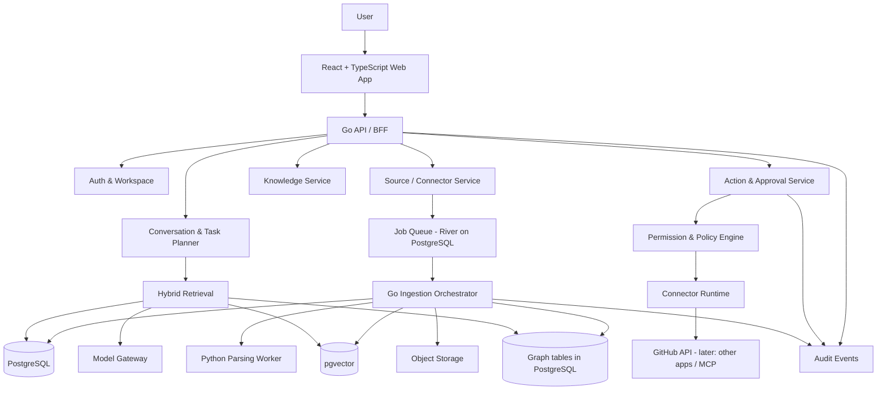
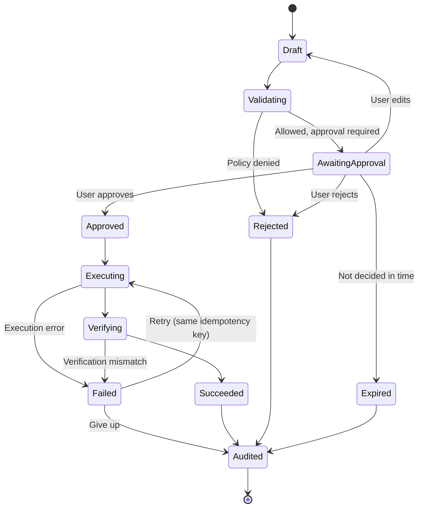

# ORIVANA — Product Requirements Document

> **Product:** ORIVANA\
> **Category:** Personal Intelligence & Action Platform\
> **Tagline:** Your Knowledge, Connected. Your Intent, in Motion.\
> **Document status:** Product blueprint / MVP planning baseline\
> **Version:** 1.1\
> **Date:** 11 November 2026

---

## 0. Changelog

| Version | Date | Changes |
|---|---|---|
| 1.0 | 11 Nov 2026 | Initial blueprint. |
| 1.1 | 11 Nov 2026 | Fixed heading hierarchy and Markdown tables. Locked initial persona (researcher) and connector (GitHub). Added Approvals and Memory to navigation; hid Automations from MVP navigation. Extended data model (page-level chunk locations, message citations, jobs, relationship status, memory supersession, fixed embedding dimension). Completed API (auth flows, edit/revoke/reprocess/export). Decided SSE pattern. Completed action lifecycle. Locked "all writes require approval" for MVP. Added PDF parsing and queue decisions. Added walking-skeleton milestones. |

---

## 1. Executive summary

ORIVANA is a personal intelligence workspace that connects a user's digital information, builds a traceable knowledge model from it, remembers context over time, and uses that context to help complete work across connected applications.

Its central product thesis is **Knowledge-to-Action Intelligence**:

1. Collect information from sources the user authorizes.
2. Organize information into searchable documents, memories, and a knowledge graph.
3. Retrieve evidence and relationships relevant to a question or task.
4. Plan a workflow using the user's context and permissions.
5. Execute approved actions through connectors, APIs, MCP tools, or browser automation.
6. Record what happened, what evidence was used, and what changed.

ORIVANA is not positioned as a replacement for every note-taking, automation, or AI product. It is the context and reasoning layer between a person's knowledge and the tools they use.

### One-sentence value proposition

**ORIVANA turns fragmented personal knowledge into traceable context that can power useful, controlled actions across applications.**

### Product boundary

ORIVANA is an assistant and orchestration layer. It does not claim to reproduce human consciousness, guarantee factual correctness, or autonomously perform high-impact actions without appropriate authorization.

### Brand identity

**ORIVANA** is a coined brand name created for this product. It is intentionally not tied to a single technical category such as RAG, knowledge graphs, or AI agents, so the product can evolve without outgrowing its name.

| Attribute | Value |
|---|---|
| Product name | ORIVANA |
| Category | Personal Intelligence & Action Platform |
| Tagline | Your Knowledge, Connected. Your Intent, in Motion. |
| Core idea | Connect knowledge, preserve context, and turn informed intent into controlled action. |
| Brand personality | Thoughtful, precise, calm, capable, and human-centered. |

Use the category and tagline exactly as written above in every document, prompt, and screen. Do not use "autonomous" in the category name.

The name is a creative working name, not a statement of trademark or domain availability. Complete formal trademark, company-name, domain, and social-handle checks before public launch. A preliminary web search found unrelated businesses using "Orivana" in the food sector (e.g., a bakery company in Argentina and a spice brand); these are different trade classes but suggest the `.com` domain may be unavailable.

---

## 2. Problem statement

People accumulate useful information across disconnected systems: PDFs, browser bookmarks, email, notes, chat histories, source-code repositories, cloud drives, and task applications. The information is difficult to search collectively, relationships between items are rarely explicit, and the context behind decisions is easily lost.

Existing tools often specialize in one layer:

- Note-taking tools organize manually created notes.
- Search tools retrieve documents or web pages.
- RAG applications answer questions from selected corpora.
- Automation platforms connect triggers and actions.
- AI agents execute tasks but may lack durable, traceable personal context.

The opportunity is to connect these layers while preserving source provenance, user control, and a coherent memory model.

### User pain points

1. **Fragmentation:** relevant information lives in many applications.
2. **Context loss:** users forget why a decision was made or how a project evolved.
3. **Weak relationships:** ordinary search finds similar text but may miss explicit relationships between entities, claims, projects, and events.
4. **Low trust:** generated answers can be difficult to verify against original sources.
5. **Manual handoffs:** users repeatedly copy information between research, notes, email, project tools, and code repositories.
6. **Unsafe automation:** agents may have broad permissions or insufficient visibility into proposed actions.

---

## 3. Product vision and differentiation

### Core innovation: Knowledge-to-Action Intelligence

ORIVANA combines four capabilities into one controlled loop:

- **Knowledge intelligence:** document understanding, hybrid retrieval, graph relationships, and source provenance.
- **Persistent context:** project history, decisions, preferences, and time-aware memory.
- **Action intelligence:** task planning and cross-application execution.
- **Governance:** permission scopes, approvals, audit history, and reversible actions where supported.

The differentiator is not simply "using a knowledge graph" or "connecting APIs"; both are established techniques. The product-level differentiation is the coordinated use of a **traceable, time-aware personal knowledge model as context for planning and executing cross-app actions**, with explicit evidence and permission boundaries.

### Differentiation matrix

| Capability | Basic notes/search | Typical RAG assistant | Automation platform | ORIVANA target |
|---|---|---|---|---|
| Search across sources | Partial | Corpus-dependent | Trigger-dependent | Unified authorized source index |
| Semantic retrieval | Sometimes | Yes | Usually not core | Yes |
| Explicit entity relationships | Manual/limited | Often implicit | No | Knowledge graph |
| Source-level provenance | Variable | Variable | Execution logs | First-class evidence links |
| Time-aware project memory | Limited | Context-window dependent | Workflow state | Persistent temporal memory |
| Cross-app actions | Plugins/extensions | Tool-dependent | Strong | Context-grounded actions |
| Human approval and audit | Variable | Variable | Often available | Core product requirement |
| Explain why an action was proposed | Limited | Variable | Rule-based | Evidence + context + plan explanation |

**Important:** This matrix describes intended product positioning, not a claim that every competing product lacks these capabilities. Competitive research and user testing are required before making public comparative claims.

### Novelty and defensible contribution

ORIVANA should pursue novelty through implementation and evaluation, not by claiming that its component technologies are unprecedented.

Candidate research/product questions:

1. **(Primary for MVP)** Does graph-aware retrieval improve answer relevance over vector-only retrieval for cross-document questions?
2. Does temporal project memory reduce incorrect use of outdated decisions?
3. Does provenance-aware planning improve user trust and task verification?
4. Does a permission-aware action planner reduce unsafe or unnecessary tool calls?
5. Can one workflow use evidence from multiple sources and complete a useful cross-app task with fewer manual handoffs?

**Focus rule:** the MVP is evaluated against **one primary question** (default: Q1, because it matches MVP validation experiments 1–2 in §17). The others are tracked as secondary signals and become the focus of later phases. If ORIVANA is used as an academic project, state exactly one research question as the main contribution.

---

## 4. Target users and use cases

### Initial persona (locked for MVP)

**Researchers and postgraduate students who keep code or experiment notes in GitHub.**

Rationale: they have frequent cross-document questions, recognize the value of citations and project memory, can judge retrieval quality, and have a natural write action (creating a GitHub issue in an experiment repository from a finding).

### Segments

| Segment | Main problem | Example value | Phase |
|---|---|---|---|
| Researchers and postgraduate students | Papers, notes, methods, and decisions are scattered | Compare literature, trace claims, maintain project context | **MVP** |
| Developers and technical leads | Documentation, issues, code, and incident context are fragmented | Connect repository knowledge with tickets and technical notes | Post-MVP |
| Knowledge workers and consultants | Repeated research and document-to-action work | Prepare briefs, update project records, draft follow-ups | Post-MVP |
| Independent professionals | Many tools, limited time for administration | Personal context hub and controlled task automation | Later |

### Later segments

- Small teams sharing selected knowledge spaces.
- Small businesses with repeatable document and communication workflows.
- Educators and analysts managing large knowledge collections.

Do not initially target regulated enterprise workflows, autonomous financial actions, or high-risk decisions.

### Jobs to be done (MVP)

- "Find the decision I made about this project and show the evidence behind it."
- "Compare these papers and map which methods, datasets, and findings they share."
- "Create a GitHub issue in my experiment repo from this finding, but show me the proposed issue before creating it."
- "Summarize the current state of my project using the latest confirmed decisions."

Post-MVP: "When a new paper enters this folder, extract its methods and prepare a linked note."

---

## 5. Product principles

1. **Evidence before confidence:** answers link to source passages where possible.
2. **User-owned context:** users can inspect, correct, export, and delete their data and memories.
3. **Permission before action:** read, write, send, delete, and publish permissions are distinct.
4. **Human control by default:** in the MVP, every write action requires explicit approval.
5. **Time matters:** current facts, historical facts, and superseded decisions must be distinguishable.
6. **Progressive complexity:** begin with a useful personal workspace; introduce graph exploration and agents as users need them.
7. **Provider independence:** model providers and connectors are replaceable behind interfaces.
8. **No magical memory claims:** the system shows what it remembers and where that memory came from.

---

## 6. Product scope

### 6.1 MVP — build this first

**MVP goal:** a single researcher can upload a small set of papers and notes, ask questions across them with page-level evidence, inspect a useful knowledge graph, maintain project memory, and create one approved GitHub issue.

| MVP feature | Description | Acceptance criteria |
|---|---|---|
| Authentication | Registration, email verification, login, logout, password reset | Private user workspace; protected routes; verified email required before ingestion |
| Workspace | Personal space, settings, project grouping | User sees only authorized workspace data (tenant isolation tests pass) |
| File ingestion | Upload PDF, Markdown, TXT | Job status visible; extraction result; retry and clear error state |
| Source library | Browse, filter, preview, reprocess, delete | Every indexed chunk links to source, page, and section |
| Hybrid search | Keyword + vector retrieval | Results show source title, page/section, and passage |
| Evidence-grounded chat | Ask questions over selected/all permitted sources | Answer includes page-level citations stored in `message_citations`; abstains when evidence is insufficient |
| Knowledge graph v1 | Extract a limited set of entity types and typed relationships | Nodes and edges link to source evidence; unconfirmed edges are visually distinct |
| Project memory | Project summaries, decisions, dated events | User can inspect, confirm, edit, supersede, and delete memory records |
| One connector: GitHub | OAuth; read repositories and issues; one write action: create issue | Read-only by default; create-issue behind approval |
| Action proposal | Agent prepares an action with arguments and evidence | User can edit, approve, or reject; nothing executes without approval |
| Approvals inbox | Central list of pending proposals | Pending count visible in navigation |
| Audit log | Ingestion, retrieval, tool calls, approvals, outcomes | User can inspect action history and failures |
| Data controls | Export and delete source/workspace/account data | Deletion propagates to chunks, embeddings, graph evidence, and memories per documented policy |

### 6.2 Post-MVP

- Automations: scheduled and event-triggered workflows (Phase 4).
- Browser connector and more application integrations.
- Configurable approval policy for low-risk writes.
- Temporal graph and contradiction detection.
- Multi-agent collaboration with specialist roles.
- Local model support and hybrid local/cloud routing.
- Voice and multimodal ingestion.
- Collaborative knowledge spaces.
- Advanced visual workflow builder.
- Proactive insights and notifications.
- Google OAuth sign-in and MFA.

### 6.3 Explicitly out of scope for MVP

- Fully autonomous agents with unrestricted access.
- Digital consciousness or a claim to replicate a person.
- Public social network or marketplace.
- Any sending, purchasing, deleting, or publishing without approval.
- Automations UI (hidden behind a feature flag).
- Complex team/enterprise administration.
- Guaranteed correctness of generated conclusions.
- Full video understanding and continuous screen monitoring.
- Marketing landing page beyond a minimal sign-in entry (design it, but it does not block the MVP).

### 6.4 MVP milestones (walking skeleton)

Build a thin end-to-end slice first, then widen it. Each milestone ends in a demo.

| Milestone | Scope | Demo |
|---|---|---|
| M1 — Cited answer | Auth (basic), one workspace, upload PDF, Python parsing, chunks with page numbers, embeddings, vector + full-text search, cited chat with SSE | "Upload two papers, ask a question, click a citation, land on the right page." |
| M2 — Library and projects | Source library, reprocess/delete, projects, email verification, password reset, audit events for ingestion and retrieval | "Organize papers into a project; delete one and see its citations disappear." |
| M3 — Graph | Entity/relationship extraction (limited types), graph explorer, evidence on edges, candidate vs confirmed | "Show which papers share a method and the passages that say so." |
| M4 — Memory | Decision records, candidate memories from conversations, confirm/edit/supersede | "Ask about the project's current approach; the answer uses the confirmed decision, not the superseded one." |
| M5 — Action | GitHub OAuth, read issues, create-issue proposal, approvals inbox, execution, verification, audit | "Turn a finding into a GitHub issue after previewing and approving it." |
| M6 — Hardening | Export/delete account, rate limits, tenant isolation tests, prompt-injection tests, evaluation set | "Run the evaluation set and the isolation test suite." |

---

## 7. Information architecture and main modules

Navigation order in the product:

1. **Home / Command Center**
   - Global search and assistant input.
   - Recent projects, recent sources, pending approvals.
   - Recent activity and ingestion/connector health.
2. **Assistant**
   - Conversational interface.
   - Source/project scope selection.
   - Answer citations and evidence panel.
   - Plan preview and action proposals.
3. **Knowledge** (tabs)
   - **Sources:** source library and document viewer.
   - **Graph:** graph explorer, entity and relationship detail.
   - **Memory:** all memories across projects, with status filters.
4. **Projects**
   - Project overview, sources, graph, memories & decisions, conversations, tasks & actions, timeline.
5. **Approvals**
   - Pending actions with badge count.
   - Before/after preview; edit, approve, reject.
   - History of decided proposals.
6. **Activity**
   - Timeline of ingestion, retrieval, tool calls, approvals, and changes.
7. **Integrations**
   - Connected applications, scopes and permissions, health, revoke/reconnect.
8. **Settings**
   - Account, security, privacy, memory controls, model preferences, export/delete.

**Automations** is a post-MVP module. It is hidden behind a feature flag in the MVP and appears in navigation (between Approvals and Activity) only when Phase 4 ships.

---

## 8. Primary user flows

### Flow A — first-time onboarding

1. User opens the landing/sign-in page.
2. User selects Sign up and submits email and password.
3. System sends a verification email; user verifies the address.
4. System creates a personal workspace with the user as Owner.
5. Onboarding explains data permissions and memory controls.
6. User uploads a first document (connecting GitHub is optional and skippable).
7. System ingests the source and shows processing status.
8. User asks a sample question and sees cited evidence.
9. User is guided to create a first project.

### Flow B — ask a question with evidence

1. User enters a question.
2. System resolves workspace/project scope.
3. Retrieval runs across keyword, vector, and (when useful) graph paths.
4. System assembles an evidence packet with chunk IDs, pages, and sections.
5. Model generates an answer constrained by the evidence packet.
6. System validates that each citation refers to a chunk in the packet, then stores `message_citations`.
7. UI displays citations and related graph entities.
8. User can open the source at the cited page, inspect a relationship, or flag an incorrect answer.

### Flow C — ingest and enrich knowledge

1. User uploads a file (or, post-MVP, a connector detects a new item).
2. API stores the original in object storage and enqueues an ingestion job.
3. Job validates type, size, and checksum (duplicate detection).
4. Python parser extracts text, page numbers, section headings, and metadata.
5. Content is chunked with page/section/offset locations preserved, then embedded.
6. Entities and candidate relationships are extracted from chunks.
7. Relationships are stored as `candidate` with provenance and confidence.
8. Index and graph are updated; audit event recorded.
9. User sees completion or a clear failure reason with a retry option.

### Flow D — knowledge-to-action

1. User asks for a task, e.g. "Create a GitHub issue from this finding."
2. Assistant retrieves relevant project context and evidence.
3. Planner proposes a structured action (repository, title, body, labels).
4. Policy engine checks connector scope and risk tier.
5. Proposal appears inline in the conversation and in the Approvals inbox.
6. User edits (returns to Draft and re-validates), approves, or rejects.
7. Connector executes the action with an idempotency key.
8. System verifies the result (issue exists with expected content) and stores an audit event.
9. The created issue is linked back to the originating evidence and project.

### Flow E — update project memory

1. User completes a project discussion or task.
2. System proposes candidate decisions, facts, and events.
3. Each candidate includes source, date, and confidence.
4. User confirms, edits, or rejects candidates.
5. Confirmed memory is linked to the project graph.
6. A new decision that replaces an old one sets `supersedes_id`; the old decision becomes `superseded` and stays in history.

---

## 9. System architecture

### 9.1 High-level architecture



### 9.2 Recommended architecture style

Use a **modular monolith first**, with clear internal packages and asynchronous workers. Split into independent services only when load, team ownership, or deployment requirements justify it.

Reasons:

- Faster development and simpler local setup.
- Easier transactions and debugging.
- Avoids premature microservice complexity.
- Allows future extraction of ingestion, model gateway, and connector runtime.

### 9.3 Recommended stack

| Layer | Recommendation | Reason |
|---|---|---|
| Frontend | React + TypeScript + Vite | Strong ecosystem for an application workspace |
| UI | Tailwind CSS + shadcn/ui | Consistent, accessible component foundation |
| Graph visualization | React Flow or Cytoscape.js | Interactive nodes, edges, and graph exploration |
| Backend | Go | API, concurrency, workers, connector orchestration |
| API contract | REST + OpenAPI; SSE for streaming | Simple integration and typed client generation |
| Primary database | PostgreSQL | Users, workspaces, sources, projects, actions, audit |
| Vector search | pgvector (fixed dimension per embedding model) | Keep MVP infrastructure simple |
| Graph store | PostgreSQL adjacency tables; Neo4j later if justified | Avoid operating a second database before graph needs are proven |
| Object storage | S3-compatible storage / MinIO locally | Original files and extracted artifacts |
| Queue | River (PostgreSQL-backed Go job queue); Redis/NATS later if needed | Transactional enqueue with the same database |
| PDF parsing | Python worker (PyMuPDF for MVP; evaluate Docling for complex layouts) | Page-level citations need reliable text, page, and heading extraction; Go PDF libraries are weaker here |
| Cache | Redis when needed | Sessions, rate limits, short-lived state |
| AI orchestration | Go interfaces + model gateway | Keep core product in Go while allowing provider swaps |
| LLM / embeddings | One hosted provider for MVP behind the gateway; one embedding model with a fixed dimension | Choose in Phase 0 by cost and quality on the evaluation set |
| Observability | OpenTelemetry + structured logs | Trace ingestion, retrieval, and agent runs |
| Deployment | Docker Compose for development | Reproducible local environment |

**Go + React is a good fit.** Python is used for **document parsing** from M1 because it is materially easier there. Keep other AI logic in Go unless a specific library justifies Python.

### 9.4 Why not start with Neo4j immediately?

For MVP, store graph entities and edges in PostgreSQL tables with indexes and bounded traversal queries (recursive CTEs, max depth 2). This is enough to validate:

- Whether users need graph exploration.
- Whether graph retrieval improves real tasks.
- Which relationship types are valuable.
- How many nodes and edges typical workspaces generate.

Adopt Neo4j when graph traversal complexity, graph algorithms, or performance measurements justify it. Avoid maintaining two sources of truth.

### 9.5 Streaming pattern (decided)

1. `POST /api/v1/conversations/{id}/messages` stores the user message, starts generation, and returns `{ message_id }` for the assistant reply.
2. The client opens `GET /api/v1/conversations/{id}/messages/{message_id}/stream` with the browser `EventSource` API.
3. Events: `status` (retrieving, generating), `token`, `citation`, `done`, `error`.
4. `POST /api/v1/conversations/{id}/messages/{message_id}/cancel` stops generation.

Reason: `EventSource` only supports GET and sends cookies automatically, which matches the HttpOnly cookie session.

---

## 10. Core data model

All tenant-owned records include `workspace_id` (and, where useful, `owner_user_id`) and are protected by authorization checks. Use PostgreSQL Row-Level Security as defense in depth. All tables have `created_at`; mutable tables also have `updated_at`.

### Core entities

| Entity | Important fields | Purpose |
|---|---|---|
| users | id, email, email_verified_at, password_hash, status | User identity |
| sessions | id, user_id, created_at, expires_at, revoked_at, user_agent, ip | Server-side sessions |
| auth_tokens | id, user_id, purpose (verify_email / reset_password), token_hash, expires_at, used_at | Email verification and password reset |
| workspaces | id, owner_user_id, name, plan | Personal/team boundary |
| workspace_members | workspace_id, user_id, role | Membership and access |
| projects | id, workspace_id, name, description, status | Context boundary |
| sources | id, workspace_id, project_id, type, title, uri, object_key, status, checksum | Original information source |
| source_versions | id, source_id, version, checksum, metadata | Source change history |
| jobs | id, workspace_id, source_id, kind, status, attempts, error_code, error_message, started_at, finished_at | Ingestion and background job status (mirrors River job state for the UI) |
| documents | id, source_id, extracted_text_uri, language, page_count | Parsed document |
| chunks | id, document_id, ordinal, text, token_count, page_start, page_end, section_path, char_start, char_end | Retrieval passages with exact location for citations |
| chunk_embeddings | chunk_id, model, embedding `vector(N)` | Semantic retrieval; N fixed per model (one table or column per model) |
| entities | id, workspace_id, project_id (nullable), canonical_name, entity_type, status | Graph nodes |
| entity_aliases | entity_id, alias | Alias resolution |
| relationships | id, workspace_id, from_entity_id, to_entity_id, relation_type, confidence, status (candidate / confirmed / rejected), extraction_method, valid_from, valid_to | Graph edges |
| evidence_links | id, relationship_id (nullable), memory_id (nullable), chunk_id, quote, char_start, char_end | Provenance; check constraint: exactly one of relationship_id / memory_id |
| memories | id, workspace_id, project_id, memory_type, content, origin (user / imported / model_proposed), status (candidate / confirmed / superseded / rejected), confidence, supersedes_id, valid_from, valid_to | Persistent memory and decision records |
| conversations | id, workspace_id, project_id, user_id, title | Chat sessions |
| messages | id, conversation_id, role, content, status (streaming / complete / cancelled / error) | Chat history |
| message_citations | id, message_id, chunk_id, quote, char_start, char_end, ordinal | Citations shown under an assistant answer |
| tasks | id, workspace_id, conversation_id, status, goal, plan_json | Agent task |
| tool_connections | id, workspace_id, provider, account_label, encrypted_credentials_ref, status, last_checked_at | External connections |
| permission_grants | id, connection_id, scopes, approval_policy | Tool permissions |
| action_proposals | id, task_id, connection_id, tool, arguments_json, risk_level, status, idempotency_key, decided_by, decided_at | Proposed external action |
| action_runs | id, proposal_id, attempt, external_ref, result_json, status, error_message | Execution result |
| audit_events | id, workspace_id, actor_type (user / agent / system), actor_id, event_type, target_type, target_id, result, request_id, metadata | Traceability |

### MVP entity types (graph)

Extracted from content: **Paper, Method, Dataset, Claim, Concept**.
Created by the system or user: **Project, Decision** (linked from memories).

Other types (Person, Task, Document, etc.) are post-MVP. Keeping the type set small reduces extraction cost and graph noise.

### Graph relationship examples

- `PAPER --USES_METHOD--> METHOD`
- `PAPER --EVALUATES_ON--> DATASET`
- `PAPER --SUPPORTS--> CLAIM`
- `PAPER --CONTRADICTS--> CLAIM`
- `DECISION --SUPERSEDES--> DECISION`
- `DECISION --DERIVED_FROM--> PAPER`
- `PROJECT --CONTAINS--> PAPER`

Relationships carry provenance, confidence, extraction method, status, and timestamps. Model-extracted relationships start as `candidate`; they are never treated as verified fact until confirmed or supported by additional evidence.

### Memory types

- **Episodic:** an event or interaction.
- **Semantic:** a fact or concept.
- **Procedural:** a repeatable preference or way of working.
- **Project:** a project-specific state, decision, or milestone.

Statuses: `candidate`, `confirmed`, `superseded`, `rejected`. User correction is always supported.

### Deletion policy (MVP)

Deleting a source deletes its object, documents, chunks, embeddings, `evidence_links`, and `message_citations` that point to its chunks. Relationships and memories left with no evidence are marked and shown to the user for review rather than silently kept. Audit events are retained but stripped of content.

---

## 11. Retrieval and reasoning design

### MVP retrieval pipeline

1. Determine user/workspace/project scope.
2. Search exact terms with PostgreSQL full-text search (BM25-style ranking can come later with a dedicated search engine).
3. Search semantically using pgvector.
4. Optionally expand through one or two graph hops for relevant entities (confirmed edges first).
5. Merge and rerank candidates (e.g., reciprocal rank fusion).
6. Build an evidence packet with chunk IDs, source titles, pages, and sections.
7. Generate a grounded answer.
8. Validate citations against the packet; return citations, uncertainty, and related entities.

### Important safeguards

- Do not invent citations; reject any citation whose chunk ID is not in the evidence packet.
- Do not claim a source supports a statement unless the cited passage was retrieved.
- Distinguish source claims from system inferences.
- Show when sources disagree.
- Show timestamps for time-sensitive memory; prefer confirmed, non-superseded memory.
- If evidence is insufficient, say so and ask for a source or clarification.
- Prevent cross-workspace retrieval (scope filter in every query, RLS as backup).
- Treat ingested content as untrusted: never follow instructions found inside documents.

### Graph extraction lifecycle

Extract candidate entities and relationships per section rather than per tiny chunk to control cost. Normalize duplicates, resolve aliases cautiously (store in `entity_aliases`), and attach each candidate to source passages. High-impact or low-confidence relationships remain `candidate` until reviewed or supported by additional evidence.

---

## 12. Agent and action architecture

### Agent roles

- **Planner:** decomposes a user goal into steps.
- **Researcher:** retrieves and synthesizes evidence.
- **Knowledge curator:** proposes entities, relationships, and memories.
- **Executor:** invokes approved tools.
- **Verifier:** checks whether the action succeeded and whether output matches the request.

These are logical roles implemented by one orchestrator in the MVP. Do not deploy five independent agents for architectural appearance.

### Action lifecycle



Retry uses the same idempotency key. Before retrying a create action, the verifier checks whether the external item already exists to avoid duplicates.

### Risk tiers

| Tier | Example | MVP behavior | Later |
|---|---|---|---|
| Read | Search files, read repository issues | Allowed within granted read scope | Same |
| Low write | Create draft note or GitHub issue | **Explicit approval required** with preview | Approval policy configurable per connection |
| External communication | Send email, publish comment | Not available in MVP | Explicit approval |
| Destructive | Delete files, remove records | Not available in MVP | Explicit confirmation and recovery strategy |
| Sensitive/high impact | Financial, legal, medical, production infrastructure | Out of scope | Specialized policy and human review |

### Connector design

Each connector implements a common interface:

- `DiscoverCapabilities`
- `Authorize`
- `RefreshCredentials`
- `Read`
- `ProposeAction`
- `ExecuteApprovedAction`
- `VerifyResult`
- `Revoke`

MVP connector: **GitHub**, using a GitHub App or OAuth App with the narrowest scopes that allow reading the selected repositories and creating issues. Encrypt credentials at rest, never expose secrets to the browser, and request least-privilege scopes.

Why not Obsidian first: a web application cannot read a local vault on the user's machine without manual upload or a local agent. Obsidian-compatible Markdown is supported in the MVP through **file upload**; a sync connector is post-MVP.

MCP can be supported as a tool integration protocol later, but it is not a universal substitute for provider-specific authentication, authorization, or API adapters.

---

## 13. Authentication, accounts, and security

**ORIVANA has login from the first MVP.** The product stores personal documents, conversations, memories, and external credentials, so workspace isolation is foundational.

### MVP authentication

- Sign up with email and password.
- Email verification (required before ingestion).
- Login and logout.
- Password reset.
- Server-side sessions using HttpOnly, Secure, SameSite cookies.
- Account deletion and data export.
- Post-MVP: Google OAuth, MFA.

### Authorization

Use roles even for a single-user MVP so the model can grow:

- **Owner:** full workspace control.
- **Admin:** manage workspace and connections.
- **Member:** use shared resources.
- **Viewer:** read-only.

For personal workspaces, the owner is the initial role. Enforce authorization in the backend for every resource; hiding UI controls is not security.

### Security baseline

- Password hashing with Argon2id.
- Hash verification/reset tokens; make them single-use and short-lived.
- TLS in transit and encryption at rest.
- Secrets stored in a secret manager or encrypted credential vault.
- CSRF protection for cookie-based authentication.
- Rate limits on login, reset, upload, and chat.
- File type/size validation and malware scanning where practical.
- Audit events for connector and agent activity.
- Tenant isolation tests.
- Prompt-injection defenses for untrusted documents.
- Data retention and deletion policy (§10).
- Backups and restore testing.

---

## 14. API design — initial proposal

Use versioned REST endpoints documented with OpenAPI. Stream assistant responses with SSE (§9.5).

| Method | Endpoint | Purpose |
|---|---|---|
| POST | `/api/v1/auth/register` | Register |
| POST | `/api/v1/auth/verify-email` | Confirm email with token |
| POST | `/api/v1/auth/resend-verification` | Resend verification email |
| POST | `/api/v1/auth/login` | Login |
| POST | `/api/v1/auth/logout` | Logout |
| POST | `/api/v1/auth/forgot-password` | Send reset email |
| POST | `/api/v1/auth/reset-password` | Set new password with token |
| GET | `/api/v1/me` | Current user and workspace |
| DELETE | `/api/v1/me` | Delete account |
| POST | `/api/v1/exports` | Start workspace data export |
| GET | `/api/v1/exports/{id}` | Export status and download link |
| GET/POST | `/api/v1/projects` | List/create projects |
| GET/PATCH/DELETE | `/api/v1/projects/{id}` | Manage project |
| GET/POST | `/api/v1/sources` | List/upload sources |
| GET | `/api/v1/sources/{id}` | Source detail |
| GET | `/api/v1/sources/{id}/chunks` | Chunk/section navigation |
| POST | `/api/v1/sources/{id}/reprocess` | Retry or reprocess ingestion |
| DELETE | `/api/v1/sources/{id}` | Delete source and derived data |
| GET | `/api/v1/jobs/{id}` | Job status |
| POST | `/api/v1/search` | Hybrid search |
| GET/POST | `/api/v1/conversations` | List/create conversations |
| GET | `/api/v1/conversations/{id}` | Conversation with messages and citations |
| POST | `/api/v1/conversations/{id}/messages` | Send message; returns assistant `message_id` |
| GET | `/api/v1/conversations/{id}/messages/{message_id}/stream` | SSE stream |
| POST | `/api/v1/conversations/{id}/messages/{message_id}/cancel` | Cancel generation |
| POST | `/api/v1/messages/{id}/feedback` | Flag incorrect answer |
| GET | `/api/v1/graph` | Query bounded subgraph (focus, depth ≤ 2, filters) |
| GET/PATCH | `/api/v1/entities/{id}` | Entity detail and evidence; confirm/rename/merge |
| GET/PATCH | `/api/v1/relationships/{id}` | Relationship evidence; confirm/reject |
| GET/POST | `/api/v1/memories` | List/create memory |
| PATCH | `/api/v1/memories/{id}` | Edit, confirm, reject, supersede |
| DELETE | `/api/v1/memories/{id}` | Delete memory |
| GET/POST | `/api/v1/connections` | List/start connection (OAuth) |
| GET | `/api/v1/connections/{provider}/callback` | OAuth callback |
| DELETE | `/api/v1/connections/{id}` | Revoke connection |
| GET/POST | `/api/v1/action-proposals` | List/create proposals (filter by status) |
| GET/PATCH | `/api/v1/action-proposals/{id}` | Detail; edit arguments (returns to Draft) |
| POST | `/api/v1/action-proposals/{id}/approve` | Approve |
| POST | `/api/v1/action-proposals/{id}/reject` | Reject |
| GET | `/api/v1/audit-events` | Activity history |

All endpoints validate workspace membership and ownership. Add cursor pagination, request IDs, idempotency keys for writes (`Idempotency-Key` header), and structured error responses (`code`, `message`, `details`, `request_id`).

---

## 15. UI/UX requirements

### Product design direction

- Desktop-first workspace with responsive behavior.
- Calm, professional, high-density but readable interface.
- Dark theme as the initial visual direction; light theme can follow.
- Avoid a "generic chatbot dashboard" appearance.
- Make evidence, graph relationships, project context, and pending actions visible.
- Use progressive disclosure: advanced graph and agent details should not overwhelm new users.

### Main navigation (MVP)

Home · Assistant · Knowledge · Projects · Approvals · Activity · Integrations · Settings

(Automations is added after Phase 4.)

### Critical screens (MVP order)

1. Sign in / Sign up / verify email / reset password.
2. Onboarding and first upload.
3. Home / Command Center.
4. Assistant conversation with evidence panel.
5. Source library and document viewer.
6. Knowledge graph explorer.
7. Memory management.
8. Project workspace and decision timeline.
9. Approvals inbox and action review.
10. Integrations and permission scopes.
11. Activity and audit.
12. Settings, privacy, and security.

Post-MVP: Automation builder and run history; full landing page.

Detailed visual requirements are in `UI.md`.

---

## 16. Non-functional requirements

| Area | MVP target |
|---|---|
| Reliability | Clear job status, retry handling, idempotent action execution |
| Performance | Fast local navigation; stream long AI responses; first token latency measured |
| Scalability | Background ingestion; pagination; bounded graph traversal (depth ≤ 2) |
| Security | Workspace isolation and least-privilege connector scopes |
| Observability | Correlation IDs across API, jobs, model calls, and tool calls |
| Accessibility | WCAG 2.2 AA target: keyboard navigation, labels, contrast, focus states |
| Portability | Docker Compose development environment; provider abstraction |
| Data integrity | Page/section/offset preserved through chunking, citations, and graph extraction |
| Cost control | Token usage tracking per workspace, model routing, ingestion quotas |

Avoid hard performance promises until a benchmark dataset and deployment profile exist. Establish baseline metrics during MVP.

---

## 17. Product metrics and validation

### Activation

- Percentage of users who verify email and ingest a first source.
- Time from signup to first cited answer.
- Percentage who create a first project.

### Knowledge quality

- Retrieval precision/recall on a curated evaluation set.
- Citation correctness (cited passage supports the claim).
- Entity resolution accuracy.
- Relationship precision.
- Rate of outdated or conflicting memory surfaced incorrectly.

### Action quality

- Proposed action approval rate.
- Successful execution rate.
- Verification success rate.
- Failed/duplicate action rate.
- Percentage of actions edited before approval.

### Trust and retention

- User corrections to memory.
- Source inspection rate (citation clicks).
- Repeat weekly use.
- Data export/deletion completion.
- User-reported trust and usefulness.

### MVP validation experiments

1. Compare vector-only retrieval against hybrid retrieval.
2. Compare hybrid retrieval with and without graph expansion (primary question).
3. Test whether citations help users detect incorrect answers.
4. Test whether project memory improves follow-up questions.
5. Test whether action previews reduce accidental writes.

### Evaluation set

Build in Phase 0: 20–40 papers from one research area, 50–100 questions with expected source passages (including cross-document and "no answer" questions). Re-run on every retrieval change.

---

## 18. Development roadmap

### Phase 0 — Product and technical validation

- Interview 5–10 target researchers.
- Collect representative papers and questions; build the evaluation set.
- Choose LLM provider and embedding model (fix the vector dimension).
- Validate PDF parsing quality (page numbers, headings, tables) with PyMuPDF; test Docling on failures.
- Prototype the graph data model.

### Phase 1 — Secure knowledge workspace (M1–M2)

- Auth and workspace isolation.
- Projects and source library.
- PDF/Markdown/TXT ingestion with page-level chunks.
- PostgreSQL, object storage, pgvector, River.
- Hybrid search and cited chat with SSE.

### Phase 2 — Graph and memory (M3–M4)

- Entity and relation extraction (MVP types).
- Graph visualization.
- Evidence/provenance links.
- Project memory and decision timeline.
- User correction and confirmation.

### Phase 3 — Controlled actions (M5–M6)

- GitHub connector.
- Action proposal schema.
- Permission engine, approvals inbox, and review UI.
- Audit log and result verification.
- Export/delete and hardening.

### Phase 4 — Workflow intelligence

- Automations module (scheduled and event-based workflows).
- Planner and verifier improvements.
- Retry and failure recovery.
- More connectors (Obsidian sync, Google Drive).

### Phase 5 — Advanced platform

- Multi-agent orchestration.
- Temporal reasoning and contradiction detection.
- Local model support.
- Voice and multimodal ingestion.
- Collaborative knowledge spaces.

---

## 19. Suggested repository structure

```text
orivana/
├── apps/
│   └── web/                     # React + TypeScript
├── services/
│   └── api/                     # Go API application (cmd/api, cmd/worker)
├── workers/
│   └── parser/                  # Python PDF/Markdown parsing worker
├── packages/
│   ├── ui/                      # Shared UI components
│   └── api-client/              # Generated/typed API client (from OpenAPI)
├── internal/
│   ├── auth/
│   ├── workspace/
│   ├── projects/
│   ├── sources/
│   ├── ingestion/
│   ├── retrieval/
│   ├── knowledge/
│   ├── memory/
│   ├── assistant/
│   ├── agents/
│   ├── connectors/
│   ├── actions/
│   ├── approvals/
│   └── audit/
├── migrations/
├── eval/                        # Evaluation set and scripts
├── deploy/
│   ├── docker/
│   └── compose.yaml
├── docs/
│   ├── PRD.md
│   ├── UI.md
│   ├── ARCHITECTURE.md
│   └── API.md
└── README.md
```

This is a starting structure, not a requirement to create every package on day one. Keep the codebase modular without splitting it into many deployable services prematurely.

---

## 20. Key risks and mitigations

| Risk | Mitigation |
|---|---|
| Graph becomes noisy | Small entity type set, confidence, provenance, deduplication, candidate status, user correction |
| Incorrect AI answers | Evidence-first retrieval, abstention, citation validation against the evidence packet |
| Poor PDF extraction breaks citations | Python parser with page/heading extraction; parsing quality checked in Phase 0; reprocess action |
| Stale memories | Temporal fields, supersession, source refresh |
| Unsafe actions | Least privilege, approval for every write, idempotency, verification, audit |
| Duplicate external actions on retry | Idempotency key + pre-retry existence check |
| Connector breakage | Connector health checks, retries, versioned adapters |
| High model cost | Section-level extraction, model routing, caching, quotas, batch ingestion |
| Embedding model change | Fixed-dimension column per model; re-embed job |
| Scope creep | Locked persona, one connector, walking-skeleton milestones |
| Privacy concerns | Data controls, encryption, isolation, clear retention |
| Difficult graph queries | Bounded use cases (depth ≤ 2), benchmark before adopting a graph DB |

---

## 21. Product success definition

The MVP is successful when a target researcher can:

1. Create a secure account, verify email, and get a private workspace.
2. Add papers and see ingestion status.
3. Ask a question across those papers and receive an answer with page-level, verifiable evidence.
4. Explore at least one useful relationship between papers or concepts.
5. Maintain a project decision or memory with its source and date, including superseding an old decision.
6. Prepare one GitHub issue, inspect it, approve it, and verify the result.
7. Review the audit history and export or delete their stored data.

**The product should prove this loop before expanding into a broad autonomous platform.**

---

## 22. Final positioning

ORIVANA is a **Personal Intelligence & Action Platform** built around Knowledge-to-Action Intelligence.

Its promise is not that AI knows everything about a person or can safely do anything on their behalf. Its promise is that a user's authorized knowledge can become more connected, traceable, useful, and actionable — while the user remains in control.
